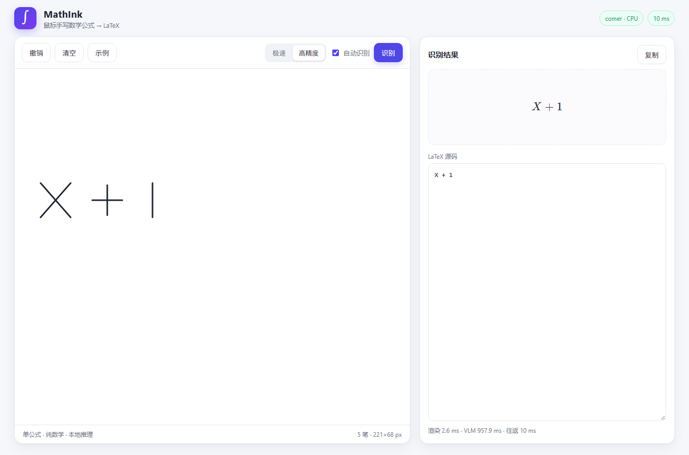

# MathInk

手写数学公式 → LaTeX。本地服务 + 浏览器界面，模型全部离线，单公式 **< 1 秒**。



> 状态：v0.3，2026-11-16。双引擎：**Uni-MuMER 2B（GPU，默认）** + CoMER INT8（CPU，兜底）。
> 非商用项目；CROHME 数据与权重仅限研究/自用。

## 快速开始

```powershell
# 1) 下载模型与运行时（首次约 1.6 GB）
.\.venv\Scripts\python scripts\download_models.py --engine comer
.\.venv\Scripts\python scripts\download_models.py --engine vlm --llama

# 2) 启动
powershell -ExecutionPolicy Bypass -File start.ps1
```

打开 <http://127.0.0.1:8848>，按住鼠标/触控笔写公式，停笔约 0.9 s 自动识别；
也可以点「示例」先看效果。

> 没有 GPU 或不想下 1.5 GB 模型？只装 CoMER 也能用，界面里切到「极速」。

## 实测（CROHME 2019）

| 引擎 | 输入 | 完全正确 | ≤1 处修改 | p50 |
| --- | --- | --- | --- | --- |
| **Uni-MuMER 2B Q4** | ≤5 符号（209 张） | **81.3%** | **93.3%** | **61 ms** |
| Uni-MuMER 2B Q4 | 400 张全长度 | **72.3%** | 86.0% | 120 ms |
| CoMER INT8 | ≤5 符号（209 张） | 73.7% | 91.4% | 224 ms |
| CoMER INT8 | 400 张全长度 | 58.0% | — | 537 ms |

画布实测：`x+1` 约 55–105 ms（VLM / CoMER），700 px 长公式约 360 ms（CoMER）。
**短公式 81% 无需修改、93% 改一处即可**；长公式 VLM 也明显强于 CoMER（≥15 符号 130/195 全对）。

## 功能

- 鼠标/触控/触控笔画布，自适应浏览器窗口大小；撤销、清空、示例
- 双引擎切换：高精度（VLM，GPU）/ 极速（CoMER，CPU）
- 停笔自动识别（可关）
- KaTeX 本地预览 + 可编辑 LaTeX 源码 + 实时重渲染 + 一键复制
- 实时显示渲染/VLM/编码/解码/往返耗时；超过 1 s 变黄
- 页脚显示内容尺寸，写得过小/过大时提示
- 全离线：KaTeX、模型、前端资源都在本地

## 架构

```
浏览器画布 ──strokes JSON──▶ FastAPI ─┬─▶ Uni-MuMER 2B (llama.cpp / Vulkan, GPU)
                                      │        └─ 渲染 PNG → /v1/chat/completions
                                      └─▶ CoMER INT8 (ONNX, CPU, 兜底)
                                                │
                           LaTeX 修复/归一化 ◀──┘
                                      │
                          浏览器 KaTeX 预览 ◀── JSON
```

| 目录 | 说明 |
| --- | --- |
| `backend/app/main.py` | FastAPI、引擎路由、静态站点 |
| `backend/app/engines/vlm.py` | llama-server 管理 + OpenAI 兼容调用 |
| `backend/app/engines/comer.py` | ONNX 会话、贪心/beam 解码、计时 |
| `backend/app/image_ops.py` | 笔画渲染（CoMER / VLM 两套预处理） |
| `backend/app/latex_utils.py` | 括号/参数修复、归一化 |
| `web/` | 单页前端（原生 JS + KaTeX） |
| `models/comer/` | 7.2 MB ONNX |
| `models/vlm/` | 1.5 GB GGUF（模型 + 视觉投影） |
| `tools/llama/` | llama.cpp Windows Vulkan 运行时 |
| `scripts/` | 模型下载、CROHME 评测 |
| `docs/` | 调研、方案、输入方案 |

## 引擎说明

**高精度（默认）：Uni-MuMER 2B**
- 基座 Qwen3-VL-2B，NeurIPS 2025 Uni-MuMER 微调，Apache-2.0
- GGUF Q4_K_M + mmproj Q8，llama.cpp Vulkan 后端，4060/4070 级别即可
- 同机实测比 CoMER 更快（GPU）且更准

**极速（兜底）：CoMER INT8**
- 7.2 MB，CPU 可跑，无需 GPU
- 113 token 词表：四则、分式、根号、上下标、`\int \sum \lim`、常用希腊字母
- 不支持矩阵、`\partial`、多行、中文

## 能力边界

- 单行公式；复杂矩阵/多行仍建议拆开写
- 符号级歧义（`a/α`、`8/g`、大小写）仍会出现，靠编辑框修正
- VLM 输出不受 113 词表限制，但训练分布仍以 CROHME 风格为主

## 文档

- [方案调研（全景对比）](docs/01-调研与方案.md)
- [方案收敛与实现记录](docs/02-方案收敛与实现记录.md)
- [输入方案调研：鼠标之外的选择](docs/03-输入方案调研.md)

## 许可与致谢

- Uni-MuMER：Apache-2.0；基座 Qwen3-VL-2B（Apache-2.0）
- CoMER：ECCV 2022，代码仓库未声明许可；ONNX 权重由 [ink-on](https://github.com/kimseungdae/ink-on)（Apache-2.0）打包
- llama.cpp：MIT
- CROHME 数据：仅限研究，禁止商用
- KaTeX：MIT
- 本项目仅用于学习/研究，非商用
