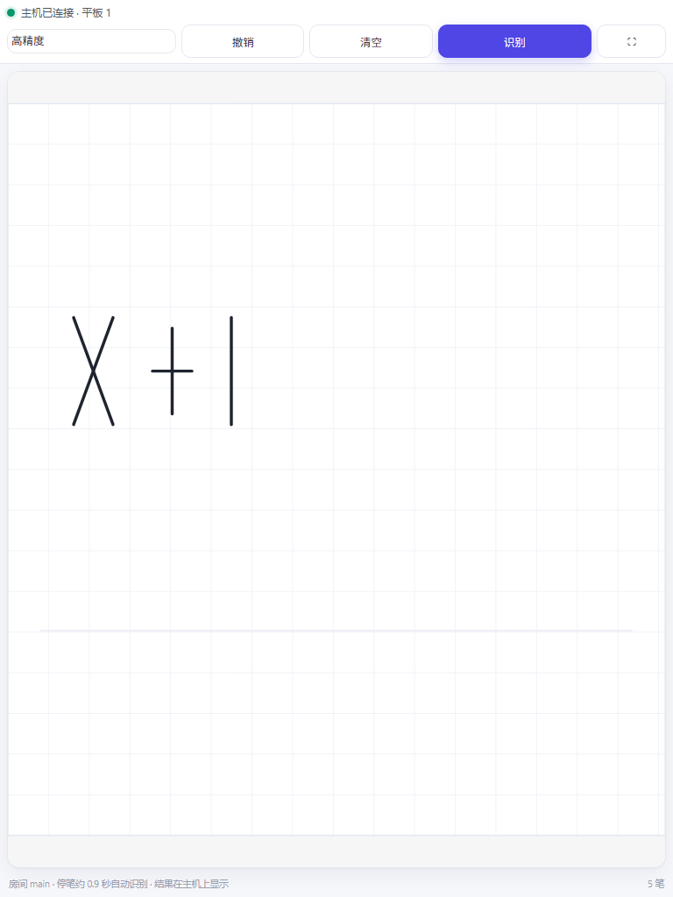

# MathInk

[](https://github.com/chengkai7300/MathInk/actions/workflows/ci.yml)
[](https://github.com/chengkai7300/MathInk/releases)
[](LICENSE)

平板书写，主机取 LaTeX。局域网双端：**平板当输入板，PC 当显示/复制端**，模型全部离线。

项目地址：<https://github.com/chengkai7300/MathInk>

| 主机端（PC） | 平板端（触控笔） |
| --- | --- |
|  |  |

> 状态：**v0.1.3-test**（2026-11-18）。Uni-MuMER 2B（GPU，默认）+ CoMER INT8（CPU，兜底）。
> 非商用项目；CROHME 数据与权重仅限研究/自用。变更见 [CHANGELOG.md](CHANGELOG.md)。

## 使用方式

### 方式一：`MathInk.exe`（推荐）

1. 从 [Releases](https://github.com/chengkai7300/MathInk/releases) 下载 `MathInk.exe`，放到项目目录
   （与 `models/`、`tools/` 同级）——直接放在仓库根目录即可
2. 双击启动，通知区域出现 MathInk 图标
3. 打开 <http://127.0.0.1:8848>（托盘双击图标也可以）

exe 内置 Web 服务和 CoMER，**单独放到任何文件夹都能用 CPU 模式**；
要高精度 VLM，需要 exe 旁边有 `models/vlm/` 和 `tools/llama/`。
停止：托盘右键「退出」或 `MathInk.exe --stop`。

> 首次运行 Windows 可能提示"未知发布者"（未签名），选「更多信息 → 仍要运行」。

### 方式二：源码运行

```powershell
# 0) 克隆（或直接下载源码包）
git clone https://github.com/chengkai7300/MathInk.git
cd MathInk

# 1) 创建虚拟环境、装依赖
python -m venv .venv
.\.venv\Scripts\pip install -r backend\requirements.txt

# 下模型（CoMER 必装；VLM 可选但推荐，约 1.5 GB）
.\.venv\Scripts\python scripts\download_models.py --engine comer
.\.venv\Scripts\python scripts\download_models.py --engine vlm --llama

# 启动（监听 0.0.0.0，局域网可访问）
powershell -ExecutionPolicy Bypass -File start.ps1
```

1. **PC** 打开 <http://127.0.0.1:8848>，右侧会显示二维码和地址 `http://<局域网IP>:8848/pad`。
2. **平板** 连同一个 Wi-Fi，扫码（或手动输入地址）打开书写页。
3. 用触控笔在平板上写公式（也可以直接在 PC 左侧画布上用鼠标写）；停笔约 0.9 秒自动识别，PC 上出现渲染结果，点「复制 LaTeX」即可粘贴到文档。

> 首次连接若平板打不开：在 Windows 防火墙提示里允许 Python 访问**专用网络**；
> 或管理员执行
> `netsh advfirewall firewall add rule name="MathInk 8848" dir=in action=allow protocol=TCP localport=8848`。
> 若主机页面显示的 IP 不对（VPN/虚拟网卡），启动前设 `MATHINK_LAN_IP=192.168.x.x`。

### 启动与停止

```powershell
# 启动：后台运行，通知区域出现 MathInk 图标
powershell -ExecutionPolicy Bypass -File .\start.ps1

# 调试：前台运行，日志直接打印（Ctrl+C 退出）
powershell -ExecutionPolicy Bypass -File .\start.ps1 -Console

# 停止（任选其一）
#  1) 右键通知区域图标 → 「退出 MathInk（彻底关闭）」
#  2) 命令行
powershell -ExecutionPolicy Bypass -File .\stop.ps1
```

托盘图标（可能在 `^` 展开区，可拖到任务栏常驻）菜单：

| 菜单项 | 作用 |
| --- | --- |
| 打开主机端 / 双击图标 | 打开 <http://127.0.0.1:8848> |
| 复制平板地址 | 把 `http://<LAN-IP>:8848/pad` 复制到剪贴板 |
| 状态 | 显示运行状态与端口 |
| 释放显存 | 停掉 VLM 子进程，立即释放约 1.9 GB 显存；下次识别自动重载 |
| 打开日志 | 打开 `logs/launcher.log` |
| 退出 MathInk（彻底关闭） | 停服务、停 llama-server、移除图标 |

**显存与内存行为**

- VLM 在第一次识别时才加载，约 **1.9 GB 显存 / 1.6 GB 内存**；CoMER 仅占几十 MB
- 退出（托盘或 `stop.ps1`）会停掉 `llama-server`，显存回到桌面基线
- llama-server 被放进 Windows **Job Object**：即使主程序被强杀/崩溃，显存也会被回收
- 下次启动会自动清理上次遗留的 `llama-server`
- 只用 CPU 引擎：启动前 `$env:MATHINK_VLM = "0"`

自定义端口：启动前设 `$env:MATHINK_PORT = "9000"`，停止时也设同一个值。
日志：`logs/launcher.log`、`logs/llama-server.log`。

## 功能

- **双端实时同步**：平板笔画经 WebSocket 推到主机，主机实时镜像书写过程
- **两种输入方式**：平板触控笔，或直接在 PC 主机画布上用鼠标 / 触屏写，共用同一画布
- 平板端：触控笔压感变宽、手掌防误触、撤销/清空/识别、自动识别、全屏
- 主机端：可直接书写、**停笔自动识别（可关）**、KaTeX 预览、可编辑 LaTeX、一键复制、最近 8 条历史
- 二维码配对：不用记 IP，扫码即用
- 双引擎：高精度（VLM，GPU）/ 极速（CoMER，CPU）
- 全离线：KaTeX、模型、前端资源都在本地
- **画布自适应**：逻辑画布按设备视口比例动态生成（横屏约 1000×684、竖屏约 630×900），
  整块画布都能写；旋转设备时自动重算，已有笔画按比例缩放

## 实测（CROHME 2019）

| 引擎 | ≤5 符号（209 张） | 400 张全长度 | p50 |
| --- | --- | --- | --- |
| **Uni-MuMER 2B Q4** | **81.3%**（≤1 改 93.3%） | **72.3%**（≤1 改 86.0%） | **61 / 120 ms** |
| CoMER INT8 | 73.7%（≤1 改 91.4%） | 58.0% | 224 / 537 ms |

端到端（平板笔画 → 主机显示结果）实测约 **200–260 ms**（含 WebSocket 往返与渲染）。

## 架构

```
平板浏览器 ──WS(stroke/preview/recognize)──▶ FastAPI ──┬─▶ Uni-MuMER 2B (llama.cpp/Vulkan, GPU)
   ▲                                                  └─▶ CoMER INT8 (ONNX, CPU)
   │  WS(result/state)                                     │
   └────────────────────────────── PC 浏览器 ◀──WS(result)──┘
```

| 目录 | 说明 |
| --- | --- |
| `backend/app/main.py` | HTTP + WebSocket + 二维码 + 静态站点 |
| `backend/app/session.py` | 双端共享画布状态与广播 |
| `backend/app/engines/vlm.py` | llama-server 管理 + 调用 |
| `backend/app/engines/comer.py` | ONNX 会话、解码、计时 |
| `web/index.html` + `host.js` | PC 主机端 |
| `web/pad.html` + `pad.js` | 平板书写端 |
| `models/` | CoMER 7.2 MB；VLM 1.5 GB |
| `tools/llama/` | llama.cpp Windows Vulkan 运行时 |
| `scripts/` | 模型下载、CROHME 评测、WS 冒烟测试 |
| `docs/` | 调研、方案、输入方案 |

## 引擎说明

**高精度（默认）：Uni-MuMER 2B** — Qwen3-VL-2B + Uni-MuMER 微调，GGUF Q4，Apache-2.0。
**极速（兜底）：CoMER INT8** — 7.2 MB，CPU 可跑；113 token 词表，不支持矩阵/偏导/多行。

## 能力边界

- 单行公式；矩阵/多行建议拆开写
- 符号级歧义（`a/α`、`8/g`、大小写）仍会出现，靠编辑框修正
- 局域网内无鉴权：同一网络的人都能访问，不要暴露到公网

## 文档

- [方案调研（全景对比）](docs/01-调研与方案.md)
- [方案收敛与实现记录](docs/02-方案收敛与实现记录.md)
- [输入方案调研：鼠标之外的选择](docs/03-输入方案调研.md)

## 开发与评测

```powershell
# 单元测试（CI 也会跑）
.\.venv\Scripts\python tests\test_smoke.py

# 双端 WebSocket 冒烟测试（需服务已启动）
.\.venv\Scripts\python scripts\ws_test.py

# CROHME 评测数据（仅研究用途，约 30 MB）
.\.venv\Scripts\python scripts\fetch_crohme.py
.\.venv\Scripts\python scripts\eval_crohme.py --gt-max-len 5 --limit 300 --variants official
.\.venv\Scripts\python scripts\eval_vlm.py --gt-max-len 5 --limit 0

# 构建单文件 exe（输出 dist\MathInk.exe）
powershell -ExecutionPolicy Bypass -File .\build_exe.ps1 -Clean
```

评测结果写入 `_research/`（已 gitignore），不会进入仓库。

## 许可证

- 本仓库**代码**：MIT（见 [LICENSE](LICENSE)）
- 模型权重与评测数据：不随仓库分发，下载后遵循各自许可；详见 [THIRD_PARTY.md](THIRD_PARTY.md)
- 商用前请替换掉基于 CROHME 训练的权重，并逐项复核许可

致谢：Uni-MuMER、Qwen3-VL、CoMER、llama.cpp、KaTeX、CROHME。
