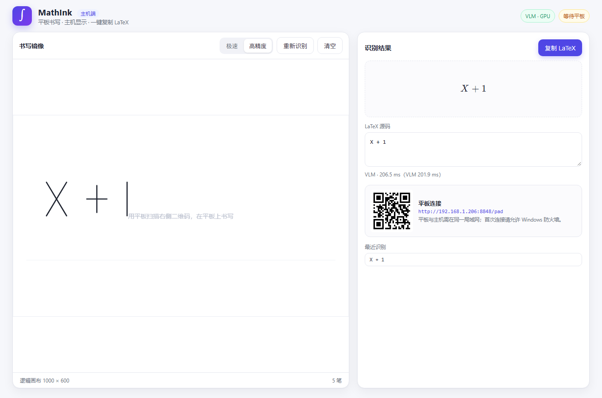
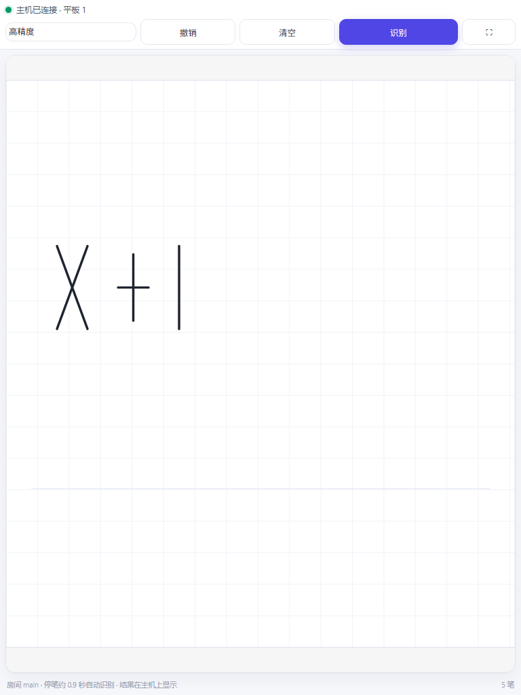

# MathInk v0.1.0-test

**首个公开测试版**：平板书写，主机取 LaTeX。局域网双端、模型全离线、单公式约 0.2 秒。

| 主机端（PC） | 平板端（触控笔） |
| --- | --- |
|  |  |

## 亮点

- **双端模式**：一个服务、两个界面。平板打开 `/pad` 书写，PC 打开 `/` 实时镜像、预览、复制 LaTeX
- **二维码配对**：主机页自动探测局域网 IP 并生成二维码，平板扫码即用
- **双引擎**：
  - Uni-MuMER 2B（Qwen3-VL，GGUF Q4，llama.cpp Vulkan，GPU）— 默认
  - CoMER INT8（7.2 MB ONNX，CPU）— 无 GPU / 低配兜底
- **触控笔优化**：笔压变宽、手掌防误触、全屏书写
- **完全离线**：KaTeX、模型、前端资源均在本地
- **一键启动**：`start.ps1` 负责虚拟环境、模型下载与启动

## 实测（CROHME 2019）

| 引擎 | ≤5 符号（209 张） | 400 张全长度 | p50 |
| --- | --- | --- | --- |
| Uni-MuMER 2B Q4 | **81.3%**（≤1 改 93.3%） | **72.3%**（≤1 改 86.0%） | **61 / 120 ms** |
| CoMER INT8 | 73.7%（≤1 改 91.4%） | 58.0% | 224 / 537 ms |

端到端（平板笔画 → 主机显示结果）约 **200 ms**（含 WebSocket 与渲染）。

## 安装

```powershell
git clone https://github.com/chengkai7300/MathInk.git
cd MathInk
python -m venv .venv
.\.venv\Scripts\pip install -r backend\requirements.txt

# 必需：CoMER（7.2 MB）
.\.venv\Scripts\python scripts\download_models.py --engine comer

# 推荐：VLM 高精度引擎（约 1.5 GB，含 llama.cpp 运行时）
.\.venv\Scripts\python scripts\download_models.py --engine vlm --llama
```

## 使用

```powershell
powershell -ExecutionPolicy Bypass -File start.ps1
```

1. PC 打开 <http://127.0.0.1:8848>
2. 平板连同一 Wi-Fi，扫主机页二维码（`http://<局域网IP>:8848/pad`）
3. 用触控笔书写，停笔约 0.9 秒自动识别；PC 上点「复制 LaTeX」

首次连接若失败：允许 Windows 防火墙的「专用网络」；或管理员执行
`netsh advfirewall firewall add rule name="MathInk 8848" dir=in action=allow protocol=TCP localport=8848`。
IP 探测不准时，启动前设置 `MATHINK_LAN_IP=192.168.x.x`。

## 系统要求

- Windows 10/11（当前提供的 llama.cpp 为 Windows Vulkan 构建）
- Python 3.10+
- 显存：VLM 约 2 GB；纯 CPU 可只用 CoMER
- 磁盘：源码 + CoMER 约 20 MB；加 VLM 约 1.7 GB
- 平板：支持触控笔的 iPad / Android / Windows 平板，现代浏览器

## 已知限制

- 单行公式；矩阵、多行、中文混排不保证
- 符号级歧义（`a/α`、`8/g`、大小写）仍会出现，需要编辑框修正
- 局域网模式**无鉴权**，不要暴露到公网
- 首次启动 VLM 需加载模型并 warmup，之后单张 60–120 ms
- 平板竖屏会有上下留白，建议横屏

## 许可证

- 代码：MIT
- 模型权重与评测数据不随仓库分发，各自遵循原许可；详见 [THIRD_PARTY.md](https://github.com/chengkai7300/MathInk/blob/main/THIRD_PARTY.md)
- 请勿将基于 CROHME 训练的权重用于商业产品

**完整变更**：<https://github.com/chengkai7300/MathInk/commits/v0.1.0-test>
