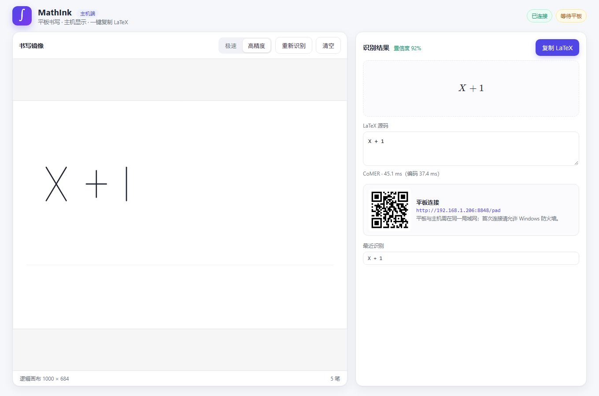
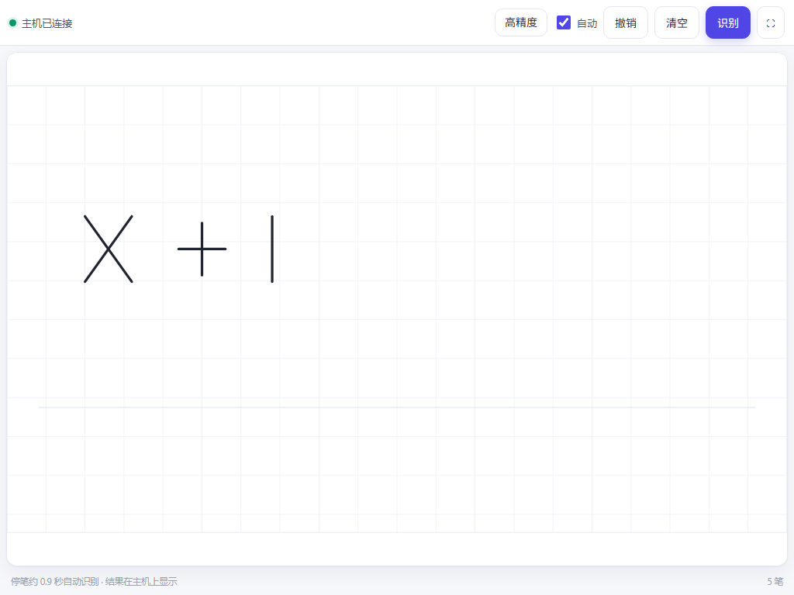

# MathInk v0.1.1-test

修复平板画布边缘不可写的问题，并把 PC 端书写保留为另一种输入方式。

| 主机端（PC，可直接写） | 平板端（横屏写满） |
| --- | --- |
|  |  |

## 修复

- **画布边缘不可写**：逻辑画布改为按设备视口比例动态生成，横屏 / 竖屏都填满整块区域
  - 横屏 1024×700 → 逻辑 1000×684
  - 竖屏 700×1000 → 逻辑 630×900
- 旋转设备时自动重算画布，已有笔画按比例缩放，不会丢或错位
- 主机镜像区用浅色遮罩标出非可写边距，避免误触

## 新增

- **PC 端直接书写**：主机页左侧画布支持鼠标 / 触屏 / 触控笔，与平板共用同一会话
- 平板与主机可以同时写，笔画实时同步（preview 也会互推）
- 主机端显示当前逻辑画布尺寸
- 恢复 GitHub Actions CI

## 安装 / 升级

```powershell
git pull
.\.venv\Scripts\pip install -r backend\requirements.txt
powershell -ExecutionPolicy Bypass -File start.ps1
```

模型无需重新下载。

## 验证

- 协议测试：横屏 1000×684、竖屏 630×900；边缘笔画（x=2、x=998）正常接收
- 主机输入：主机画一笔，平板实时收到
- 浏览器实测：主机鼠标绘制、平板右边缘绘制均成功

## 已知限制

- 单行公式；矩阵 / 多行 / 中文混排不保证
- 局域网无鉴权，不要暴露公网
- 平板与主机同时书写时，画布以最后连接的平板视口比例为准

**完整变更**：<https://github.com/chengkai7300/MathInk/compare/v0.1.0-test...v0.1.1-test>
